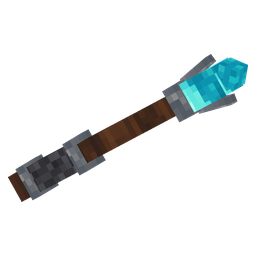
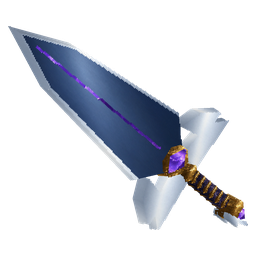
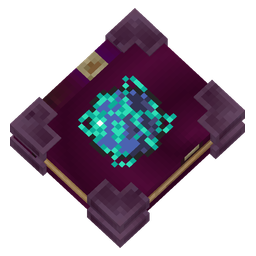
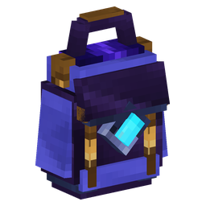
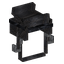
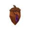

# Axo Tales

  

    
Axo Tales adds spellbooks, magical equipment and creatures to Hytale.

    

      <a class="button-link button-link--primary" href="getting-started/">Start Here</a>
      <a class="button-link" href="items/catalog/">Item catalog</a>
    

    
AxoTales 0.1.3+ for Hytale 0.7.7

  

  

    
    
    
    
  

## Explore Axo Tales

  <a class="guide-path" href="items/spellbooks/">
    
    
<h3>Spellbooks</h3>
Controls, mana costs and recipes for all 17 spellbooks.

  </a>
  <a class="guide-path" href="items/gear/">
    
    
<h3>Equipment and set bonuses</h3>
Veil, Sa'r and Ancient armor, weapons, pickaxes and permanent Backpack upgrades.

  </a>
  <a class="guide-path" href="blood-magic/">
    
    
<h3>Blood magic</h3>
Blood extraction, DNA, summoned companions and specimen storage.

  </a>
  <a class="guide-path" href="blocks-ores/">
    
    
<h3>Resources and the world</h3>
Crystal farming, ores, poisonous vines, Cloud Blocks and Bounce Blocks.

  </a>
  <a class="guide-path" href="npcs/">
    
    
<h3>Creatures and companions</h3>
Taming Whisperion and Gray Cat, bonding Elder Mages and fighting Dreadmaw.

  </a>
  <a class="guide-path" href="skill-tree/">
    
    
<h3>Runes and skills</h3>
Growing Arbor Arcanum, collecting runes and learning permanent skills.

  </a>

## Find an answer {#best-first-clicks}

| I want to... | Read |
| --- | --- |
| Craft an item or check ingredients | [Crafting Flow](crafting.md) and [Complete Item Catalog](items/catalog.md) |
| Cast different spells with the wand | [Wand & Pouch](items/arcane-equipment.md) |
| Store items in a satchel and use them for crafting | [Astral Satchel](items/astral-satchel.md) |
| Use bows, Ancient Arrows or the Spyglass | [Arrows & Spyglass](items/scout-gear.md) |
| Use souls to collect items, mine resources or guard you | [Helpful Souls](souls.md) |
| Configure a server or solve a problem | [Configuration](config.md), [Compatibility](compatibility.md) and [Troubleshooting](troubleshooting.md) |

## Quick install path

1. Use **AxoTales 0.1.3+**, built for **Hytale 0.7.7** and **Java 25**.
2. Keep one current JAR in the server's mods folder or `%APPDATA%/Hytale/UserData/Mods`.
3. Close the game or server before replacing a locked JAR, then restart. Preserve your saves and configuration.

<strong>Server values can vary.</strong> The numbers here use the mod's default settings. Server owners can change spell costs, encounter rates and world generation.

