# Complete item catalog

All **129 item definitions** are listed here, including world glyphs, crop stages and the native Azure Kelp integration. Names, descriptions, qualities, icons and crafting costs come from the current definitions. Follow the linked guides for controls and detailed mechanics.

World glyphs and internal growth states are listed at the end; they are not additional craftable equipment.

## Weapons and tools

| Item | Role and use | Crafting or acquisition |
| --- | --- | --- |
| 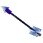{ width=40 } **[Ancient Arrow](scout-gear.md)** Epic | Carry these arrows in your hotbar, inventory or Backpack. Use a standard shortbow. Hold LMB for at least 0.35 seconds, then release at a living target. Locks onto the visible target within 96 blocks and follows it through terrain. 180 impact damage; 60 splash damage within 4 blocks. No block damage. No target: no ammunition is consumed. Native bow signatures keep their normal ammunition behavior. | 8 Adamantite Ingot, 8 Aequalis Bar, 8 Revel Bar, 12 Arcane Matter, 16 Arcane Crystal Shards, 8 White Feathers, 1 Evil Core. Arcanist's Workbench · 12s · makes 4 |
| { width=40 } **[Ancient Sword](gear.md)** Legendary | A Legendary greatsword. 160 base melee damage; 200 on a charged stab. RMB releases a 100-damage slash for 30 mana. | 1 Arcane Sword, 64 Adamantite Ingot, 96 Aequalis Bar, 160 Arcane Matter, 128 Arcane Crystal Shards, 24 Voidheart, 12 Evil Core. Arcanist's Workbench · 24s |
| 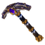{ width=40 } **[Arcane Pickaxe](gear.md)** Epic | LMB: excavate a 3×3×3 volume for 10 mana. Bedrock, containers and protected blocks are preserved. | 6 Revel Bar, 4 Aequalis Bar, 4 Arcane Matter, 8 Arcane Crystal Shards, 2 Heavy Leather, 1 Evil Core. Arcanist's Workbench · 12s |
| { width=40 } **[Arcane Sword](gear.md)** Epic | LMB: longsword combo and charged stab. RMB: Arcane Slash. 83 base damage; 105 charged damage. Primary attacks are 20% faster than a native longsword. Carrying it adds 30 maximum mana. | 60 Arcane Matter, 48 Arcane Crystal Shards, 32 Essence of Fire, 32 Essence of Ice, 16 Voidheart, 24 Aequalis Bar, 1 Evil Core. Arcanist's Workbench · 12s |
| { width=40 } **[Axo's Arcane Wand](arcane-equipment.md)** Epic | Voice of the Elder Grove Old roots remember every spell. Selected: Silver Book. Uses the original spell cost and cooldown. Keep its book in your inventory or a carried Spellbook Pouch. RMB: cast. LMB: choose a spell. Crouch+RMB: alternate action. | 6 Oak Log, 4 Cobalt Ingot, 8 Arcane Matter, 4 Arcane Crystal Shards, 6 Agretis Bar, 1 Evil Core. Arcanist's Workbench · 5s |
| 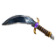{ width=40 } **[Bloodfang Daggers](gear.md)** Epic | Recurved silver blades. Grounded LMB attacks add a short dash and light knockback. 30 base damage per hit; 60% faster attack cadence. | 24 Arcane Matter, 16 Arcane Crystal Shards, 10 Heavy Leather, 16 Revel Bar, 12 Aequalis Bar, 1 Evil Core. Arcanist's Workbench · 12s |
| { width=40 } **[Everflame Shortbow](scout-gear.md)** Epic | A shortbow with endless arrows. Hits ignite the target for 4 seconds. Native draw and release controls. | 24 Cobalt Ingot, 24 Essence of Fire, 32 Arcane Matter, 8 Voidheart, 12 Heavy Leather, 8 Aequalis Bar, 1 Evil Core. Arcanist's Workbench · 12s |
| { width=40 } **[Mirethorn Shortbow](scout-gear.md)** Rare | Poisons targets and slows movement by 25% for 6 seconds. Its effects apply to every arrow type. | 16 Thorium Ingot, 8 Venom Sac, 12 Medium Leather, 24 Plant Fiber, 16 Arcane Matter, 1 Evil Core. Arcanist's Workbench · 12s |
| 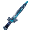{ width=40 } **[Rimefang](gear.md)** Rare | Winter's Quiet A shard of deep winter, bound in cold silver. Successful, unblocked hits freeze enemies for 2 seconds. Repeated hits refresh the freeze. Cobalt-strength sword. RMB: guard. Uses the native sword combo and signature. | 8 Cobalt Ingot, 6 Essence of Ice, 4 Arcane Matter, 3 Medium Leather, 10 Revel Bar, 1 Evil Core. Arcanist's Workbench · 6s |

## Armor

| Item | Role and use | Crafting or acquisition |
| --- | --- | --- |
| { width=40 } **[Ancient Boots](gear.md)** Legendary | +40 health, +35 mana, +25 stamina and +20% defense. Move 30% faster, jump 3 blocks higher, gain one extra air jump and take no fall damage. Full Ancient set: +400 health, +100 stamina and +50% speed. +15% attack damage, +40% elemental resistance and +50% defense. +50% maximum mana, 10 mana every 2 seconds and +50% stamina regeneration. One extra air jump. Permanently unlocks 27 bonus Backpack slots. | 32 Adamantite Ingot, 48 Aequalis Bar, 96 Arcane Matter, 64 Arcane Crystal Shards, 12 Voidheart, 6 Evil Core. Arcanist's Workbench · 20s |
| { width=40 } **[Ancient Chestplate](gear.md)** Legendary | +150 health, +20% maximum health, +25 stamina, +50% defense, +30% stamina regeneration and +30% melee/projectile damage. Enemies detect you only within 4 blocks. Crouch + jump toggles 10 seconds of flight; land to refill. Full Ancient set: +400 health, +100 stamina and +50% speed. +15% attack damage, +40% elemental resistance and +50% defense. +50% maximum mana, 10 mana every 2 seconds and +50% stamina regeneration. One extra air jump. Permanently unlocks 27 bonus Backpack slots. | 48 Adamantite Ingot, 64 Aequalis Bar, 128 Arcane Matter, 96 Arcane Crystal Shards, 16 Voidheart, 8 Evil Core. Arcanist's Workbench · 20s |
| { width=40 } **[Ancient Gauntlets](gear.md)** Legendary | +40 health, +35 mana, +25 stamina, +20% defense and +30% stamina regeneration. LMB with an empty hand casts an exploding blue fireball for 71-110 base damage. Full Ancient set: +400 health, +100 stamina and +50% speed. +15% attack damage, +40% elemental resistance and +50% defense. +50% maximum mana, 10 mana every 2 seconds and +50% stamina regeneration. One extra air jump. Permanently unlocks 27 bonus Backpack slots. | 24 Adamantite Ingot, 32 Aequalis Bar, 64 Arcane Matter, 48 Arcane Crystal Shards, 8 Voidheart, 4 Evil Core. Arcanist's Workbench · 20s |
| { width=40 } **[Ancient Helm](gear.md)** Legendary | +40 health, +35 mana, +25 stamina and +30% stamina regeneration. Breathe underwater and swim 50% faster. Restores 10 mana every 4 seconds. Reflects projectiles toward their attacker for 1.3x damage. Full Ancient set: +400 health, +100 stamina and +50% speed. +15% attack damage, +40% elemental resistance and +50% defense. +50% maximum mana, 10 mana every 2 seconds and +50% stamina regeneration. One extra air jump. Permanently unlocks 27 bonus Backpack slots. | 24 Adamantite Ingot, 32 Aequalis Bar, 64 Arcane Matter, 48 Arcane Crystal Shards, 8 Voidheart, 4 Evil Core. Arcanist's Workbench · 20s |
| { width=40 } **[Arcane Veil Hood](gear.md)** Rare | The Quiet Path Full set: +30% movement speed, +25% maximum health, +25% maximum mana, 20% damage absorption, +5 mana per second and +25% maximum stamina. Enemies detect you within 5 blocks. Permanently unlocks 9 bonus backpack slots the first time the full set is worn. Open Backpack from Inventory. Light cloth, minimal armor. | 10 Linen Scraps, 5 Arcane Matter, 4 Arcane Crystal Shards, 4 Agretis Bar, 3 Revel Bar, 1 Evil Core. Arcanist's Workbench · 6s |
| { width=40 } **[Arcane Veil Leggings](gear.md)** Rare | The Quiet Path Full set: +30% movement speed, +25% maximum health, +25% maximum mana, 20% damage absorption, +5 mana per second and +25% maximum stamina. Enemies detect you within 5 blocks. Permanently unlocks 9 bonus backpack slots the first time the full set is worn. Open Backpack from Inventory. Light cloth, minimal armor. | 12 Linen Scraps, 3 Medium Leather, 6 Arcane Matter, 4 Arcane Crystal Shards, 6 Agretis Bar, 1 Evil Core. Arcanist's Workbench · 6s |
| 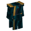{ width=40 } **[Arcane Veil Robe](gear.md)** Rare | The Quiet Path Full set: +30% movement speed, +25% maximum health, +25% maximum mana, 20% damage absorption, +5 mana per second and +25% maximum stamina. Enemies detect you within 5 blocks. Permanently unlocks 9 bonus backpack slots the first time the full set is worn. Open Backpack from Inventory. Light cloth, minimal armor. | 16 Linen Scraps, 4 Medium Leather, 8 Arcane Matter, 6 Arcane Crystal Shards, 8 Agretis Bar, 1 Evil Core. Arcanist's Workbench · 6s |
| 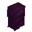{ width=40 } **[Invisibility Cloak](gear.md)** Epic | While worn, hides your character and equipment from players and conceals you from creatures. | No crafting recipe. See the [guide](gear.md) for gathering, drops or use. |
| { width=40 } **[Sa'r Armor](gear.md)** Epic | While worn, grants +75 health, +25 max mana, +10 max stamina, +25% stamina regen, +16% defense, and +25% physical/projectile damage dealt. Full Sa'r set: +35% movement speed, +30% maximum health and mana, 25% damage absorption, in addition to each piece's perks. Permanently unlocks 18 bonus backpack slots. | 12 Cobalt Ingot, 20 Arcane Matter, 10 Arcane Crystal Shards, 10 Aequalis Bar, 1 Evil Core. Arcanist's Workbench · 3s |
| { width=40 } **[Sa'r Boots](gear.md)** Epic | While worn, grants +25 max mana, +2 mana every 2s, +10 max stamina, +25% stamina regen, +16% defense, faster movement, higher jumps, one extra mid-air jump, and fall damage immunity. Full Sa'r set: +35% movement speed, +30% maximum health and mana, 25% damage absorption, in addition to each piece's perks. Permanently unlocks 18 bonus backpack slots. | 4 Dark Feathers, 4 Cobalt Ingot, 6 Arcane Crystal Shards, 12 Arcane Matter, 8 Aequalis Bar, 1 Evil Core. Arcanist's Workbench · 3s |
| { width=40 } **[Sa'r Diadem](gear.md)** Epic | While worn, grants +25 health, +25 max mana, +10 max stamina, +25% stamina regen, +16% defense, underwater breathing, and faster swimming. Full Sa'r set: +35% movement speed, +30% maximum health and mana, 25% damage absorption, in addition to each piece's perks. Permanently unlocks 18 bonus backpack slots. | 4 Arcane Crystal Shards, 2 Cobalt Ingot, 8 Arcane Matter, 6 Aequalis Bar, 1 Evil Core. Arcanist's Workbench · 3s |
| { width=40 } **[Sa'r Warfists](gear.md)** Epic | While worn, grants +25 health, +25 max mana, +10 max stamina, +25% stamina regen, +16% defense, and fires a 25-damage 2s-stun bolt on unarmed primary attacks. Full Sa'r set: +35% movement speed, +30% maximum health and mana, 25% damage absorption, in addition to each piece's perks. Permanently unlocks 18 bonus backpack slots. | 2 Azure Kelp, 2 Arcane Matter, 2 Arcane Crystal Shards, 6 Aequalis Bar, 1 Evil Core. Arcanist's Workbench · 3s |

## Spellbooks

| Item | Role and use | Crafting or acquisition |
| --- | --- | --- |
| 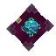{ width=40 } **[Axo's Book of Doom](spellbooks.md)** Legendary | RMB hurls a Doom Ball that deals heavy damage at a mana cost. | 2 Arcane Crystal Shards, 2 Arcane Matter, 4 Voidheart, 4 Aequalis Bar, 1 Evil Core. Arcanist's Workbench · 3s |
| { width=40 } **[Axo's Flame Book](spellbooks.md)** Legendary | RMB launches a Flame Bolt that burns foes and turns terrain to volcanic rock at a mana cost. | 2 Arcane Crystal Shards, 2 Arcane Matter, 20 Essence of Fire, 1 Evil Core. Arcanist's Workbench · 3s |
| { width=40 } **[Axo's Frost Book](spellbooks.md)** Legendary | RMB launches a Frost Shard that slows foes and turns terrain to snow brick at a mana cost. | 2 Arcane Crystal Shards, 2 Arcane Matter, 20 Essence of Ice, 4 Revel Bar, 1 Evil Core. Arcanist's Workbench · 3s |
| { width=40 } **[Axo's Healing Book](spellbooks.md)** Epic | LMB: fully heal and cleanse the target. RMB: heal and cleanse yourself. Removes poison, fire and other harmful effects; keeps beneficial buffs. | 2 Arcane Crystal Shards, 2 Arcane Matter, 4 Azure Fruit, 1 Evil Core. Arcanist's Workbench · 3s |
| { width=40 } **[Axo's Horde Book](spellbooks.md)** Epic | RMB summons a short-lived brute horde to fight for you at a mana cost. | 2 Arcane Crystal Shards, 2 Arcane Matter, 3 Feran Candle, 1 Evil Core. Arcanist's Workbench · 3s |
| { width=40 } **[Axo's Immunity Book](spellbooks.md)** Epic | RMB grants brief damage immunity at a mana cost. | 2 Arcane Crystal Shards, 2 Arcane Matter, 1 Cobalt Shield, 1 Evil Core. Arcanist's Workbench · 3s |
| { width=40 } **[Axo's Light Book](spellbooks.md)** Epic | RMB launches a harmless living light ball that slows into a glowing cruise, lasts up to 2 minutes, and stops at 100 blocks or on contact. | 2 Arcane Crystal Shards, 2 Arcane Matter, 6 Cyan Crystal Shards, 1 Evil Core. Arcanist's Workbench · 3s |
| { width=40 } **[Axo's Lightning Book](spellbooks.md)** Legendary | RMB: call a lightning storm at visible terrain within 40 blocks. Sky aim centers it on you. 40-block radius. 50 damage per second for 8 seconds. Caster is spared. 80 mana; 24-second shared storm cooldown; 0.45-second invocation. Independent 10% drop chance from Dreadmaw. | 40 Arcane Matter, 32 Arcane Crystal Shards, 40 Essence of Ice, 12 Voidheart, 20 Revel Bar, 1 Evil Core. Arcanist's Workbench · 12s |
| { width=40 } **[Axo's Meteorain Book](spellbooks.md)** Legendary | RMB: call a meteor rain at visible terrain within 40 blocks. Sky aim centers it on you. 40-block radius. 50 damage per second for 8 seconds. Caster is spared. 80 mana; 24-second shared storm cooldown; 0.45-second invocation. Independent 10% drop chance from Dreadmaw. | 40 Arcane Matter, 32 Arcane Crystal Shards, 40 Essence of Fire, 12 Voidheart, 20 Aequalis Bar, 1 Evil Core. Arcanist's Workbench · 12s |
| 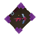{ width=40 } **[Axo's Mining Book](spellbooks.md)** Epic | RMB mines a patch of blocks where you aim at a mana cost. | 2 Arcane Crystal Shards, 2 Arcane Matter, 10 Volcanic Cobble, 1 Evil Core. Arcanist's Workbench · 3s |
| { width=40 } **[Axo's Morph Book](spellbooks.md)** Epic | RMB fires a Morph Vortex to steal a target's form at a mana cost. LMB restores your true form. | 2 Arcane Crystal Shards, 2 Arcane Matter, 2 Dark Feathers, 1 Evil Core. Arcanist's Workbench · 3s |
| { width=40 } **[Axo's Silver Book](spellbooks.md)** Common | Your first spellbook. Right-click to fire a silver-gray bolt for 10 damage. No mana required. Granted once per player in each world/server. | No crafting recipe. See the [guide](spellbooks.md) for gathering, drops or use. |
| { width=40 } **[Axo's Taunt Book](spellbooks.md)** Epic | RMB launches you upward and slams on landing for area damage at a mana cost. | 2 Arcane Crystal Shards, 2 Arcane Matter, 5 Essence of Fire, 1 Evil Core. Arcanist's Workbench · 3s |
| 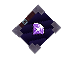{ width=40 } **[Axo's Teleport Book](spellbooks.md)** Epic | RMB teleports you to the block you are looking at; costs mana. | 2 Arcane Crystal Shards, 2 Arcane Matter, 2 Blue Crystal Shards, 1 Evil Core. Arcanist's Workbench · 3s |
| 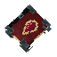{ width=40 } **[Bloody Book](../blood-magic.md)** Rare | RMB: begin an eight-second extraction. Keep aiming at a living creature within eight blocks. Taking damage, losing sight or changing items interrupts it. Each individual can give blood only once. No mana cost. Carrying this book slowly drains health. | 8 Linen Scraps, 4 Light Leather, 3 Arcane Crystal Shards, 2 Essence of Life, 1 Evil Core. Arcanist's Workbench · 5s |
| 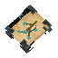{ width=40 } **[Book of Life](../blood-magic.md)** Epic | RMB: consume every DNA sample in carried inventory to awaken loyal companions. Uses ALL currently available mana. Needs some mana and safe space for every sample. Companions fight for you and survive saves/restarts. | 8 Linen Scraps, 4 Light Leather, 3 Arcane Crystal Shards, 5 Essence of Life, 1 Evil Core. Arcanist's Workbench · 5s |
| { width=40 } **[Leech Book](../blood-magic.md)** Legendary | Hold RMB to drain a living target within 16 blocks. Deals 30 damage and restores 20 health each second for 10 mana. Release, blocked sight or leaving range ends the drain. | 1 Rex Blood Sample, 1 Dreadmaw Blood Sample, 1 Yeti Blood Sample, 1 Emberwulf Blood Sample. Arcanist's Workbench · 12s |

## Potions

| Item | Role and use | Crafting or acquisition |
| --- | --- | --- |
| 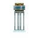{ width=40 } **[Axo's Empty Potion Bottle](potions.md)** Common | A throwable empty bottle used as the base for brewing Axo Tales potions. | 1 Empty Potion Bottle, 1 Arcane Crystal Shards, 1 Evil Core. Alchemybench · 1s |
| 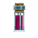{ width=40 } **[Curse Potion](potions.md)** Rare | A thrown splash vial that explodes in cursed damage. | 1 Axo's Empty Potion Bottle, 2 Arcane Crystal Shards, 5 Essence of Fire, 1 Evil Core. Alchemybench · 1s |
| 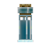{ width=40 } **[Invisibility Potion](potions.md)** Rare | Drink to fade from other players for a short time. | 1 Axo's Empty Potion Bottle, 2 Arcane Crystal Shards, 1 Azure Kelp. Alchemybench · 1s |
| 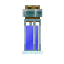{ width=40 } **[Rabbit Potion](potions.md)** Rare | Drink to leap higher for a short time. | 1 Axo's Empty Potion Bottle, 2 Arcane Crystal Shards, 1 Dark Feathers. Alchemybench · 1s |
| 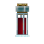{ width=40 } **[Strength Potion](potions.md)** Rare | Drink to double your outgoing damage for a short time. | 1 Axo's Empty Potion Bottle, 2 Arcane Crystal Shards, 10 Adamantite Ingot. Alchemybench · 1s |
| 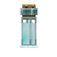{ width=40 } **[Swift Potion](potions.md)** Rare | Drink to move faster for a short time. | 1 Axo's Empty Potion Bottle, 2 Arcane Crystal Shards, 2 Cyan Hibiscus. Alchemybench · 1s |

## Souls and companions

| Item | Role and use | Crafting or acquisition |
| --- | --- | --- |
| { width=40 } **[Cruor Soul](../souls.md)** Epic | An immortal guardian. Stays behind you at a distance and retaliates against targets involved in your fights with a 10-damage bolt every 1.5 seconds. Crouch out of combat to make it wait while you approach. RMB to summon. Interact for status. LMB melee hit returns your soul as a dropped item with cargo, progress and upgrades. Empty hand + Crouch + Interact also recalls it. | 1 Evil Core, 3 Azure Kelp, 1 Ruby. Workbench · 5s |
| { width=40 } **[Fossor Soul](../souls.md)** Epic | An immortal miner. Conjures a private block and harvests one resource per minute. RMB with an Arcane Crystal or shard: +0.1 percentage points per premium ore, up to 200 feeds. Crouch + RMB feeds the held stack up to the cap. RMB to summon. Interact for status. LMB melee hit returns your soul as a dropped item with cargo, progress and upgrades. Empty hand + Crouch + Interact also recalls it. | 1 Evil Core, 3 Azure Kelp, 1 Iron Pickaxe. Workbench · 5s |
| { width=40 } **[Villa Soul](../souls.md)** Epic | An immortal courier. Collects dropped stacks within 50 blocks of its station and delivers them to the nearest chest with space. If chests fill, carried items stay safe. RMB to summon. Interact for status. LMB melee hit returns your soul as a dropped item with cargo, progress and upgrades. Empty hand + Crouch + Interact also recalls it. | 1 Evil Core, 3 Azure Kelp, 1 Gold Ingot. Workbench · 5s |
| 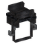{ width=40 } **[Whisperion Saddle](../npcs.md)** Uncommon | A Seat Among the Stars RMB on your tamed Whisperion to fit the saddle. Tame him with one Azure Kelp using RMB. Interact to ride; Space rises, Crouch descends, Interact dismounts. Empty hand + Crouch + Interact retrieves the saddle. | 8 Light Leather, 4 Linen Scraps, 2 Iron Ingot, 4 Agretis Bar. Workbench · 4s |

## Utility and blocks

| Item | Role and use | Crafting or acquisition |
| --- | --- | --- |
| { width=40 } **[Arcane Crystal Seed](../blocks-ores.md)** Uncommon | Mine a wild Arcane Crystal for one guaranteed seed. Plant on prepared soil. Grows from small to medium to mature in 15 minutes. Harvest for 2-3 Arcane Crystal Shards; the crystal regrows. Breaking returns its seed. | 2 Arcane Crystal Shards, 1 Arcane Matter, 2 Essence of Life. Arcanist's Workbench · 3s |
| 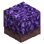{ width=40 } **[Arcane Grass](../blocks-ores.md)** Common | Grass steeped in arcane energy. | No crafting recipe. See the [guide](../blocks-ores.md) for gathering, drops or use. |
| 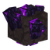{ width=40 } **[Arcane Matter Ore (Volcanic)](../blocks-ores.md)** Common | A strange ore formation fused into volcanic rock. | No crafting recipe. See the [guide](../blocks-ores.md) for gathering, drops or use. |
| { width=40 } **[Arcane Oraculum](scout-gear.md)** Legendary | Single-use. Place, then RMB to arm a 5-second blast. Spends all current mana. 4000 base damage to living entities within 250 blocks, including you; preserves terrain. | 3 Spoiled Heart, 55 Arcane Matter, 12 Arcane Crystal Shards, 12 Revel Bar. Arcanist's Workbench · 16s |
| 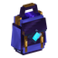{ width=40 } **[Axo's Astral Satchel](astral-satchel.md)** Epic | RMB: open storage. Search, filter and browse pages. LMB: stack; RMB: one. Toolbar: take/store visible items or Quickstack matching stored types. Workbenches use carried contents. Cannot contain another Astral Satchel. Contents follow its identity on this server. | 12 Medium Leather, 8 Spider Silk, 4 Arcane Matter, 2 Aequalis Bar, 1 Evil Core. Arcanist's Workbench · 8s |
| 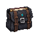{ width=40 } **[Axo's Spellbook Pouch](arcane-equipment.md)** Rare | Holds 18 spellbooks and collects newly picked-up books automatically. RMB to open. Carry it to access its spells with an Arcane Wand. | 8 Medium Leather, 8 Linen Scraps, 2 Cobalt Ingot, 4 Arcane Matter, 2 Arcane Crystal Shards, 4 Agretis Bar. Arcanist's Workbench · 5s |
| { width=40 } **[Axo's Spyglass](scout-gear.md)** Rare | Hold RMB to raise the spyglass and focus at 6× magnification. Release to lower it. Shows name, HP, mana when available and distance for the visible target. Outer lens is darkened. Display fields can be changed in spyglass-display.json. | 6 Copper Ingot, 2 Revel Bar, 2 Arcane Matter, 1 Void Crystal Shards. Arcanist's Workbench · 6s |
| 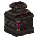{ width=40 } **[Blood Furnace](../blood-magic.md)** Epic | Smelts ores and cooks food at twice normal speed. One blood droplet fuels five minutes of active processing. Four input and four output slots. | 12 Iron Ingot, 6 Copper Ingot, 4 Revel Bar, 2 Aequalis Bar, 6 Arcane Matter, 16 Stone, 1 Evil Core. Workbench · 12s |
| { width=40 } **[Bounce Block](gear.md)** Common | A forged spring block that launches you higher with each chained bounce. | No crafting recipe. See the [guide](gear.md) for gathering, drops or use. |
| { width=40 } **[Cloud Block](gear.md)** Common | A cloud bank that boosts your motion in the direction you enter it. | No crafting recipe. See the [guide](gear.md) for gathering, drops or use. |
| { width=40 } **[Custom Placeholder Block](gear.md)** Common | A debug marker block used for testing Axo Tales worldgen. | No crafting recipe. See the [guide](gear.md) for gathering, drops or use. |
| 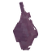{ width=40 } **[Skill Tree Seed](../skill-tree.md)** Rare | Plant in open ground. Grows into a Skill Tree in 15 real minutes. | 2 Essence of Life, 1 Purple Orchid. Arcanist's Workbench · 3s |
| 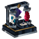{ width=40 } **[Vitae Extractor](../blood-magic.md)** Uncommon | Converts 1 blood sample and 1 Essence of Life into 1 DNA sample in five seconds. Place and Interact to open. LMB transfers a stack; RMB transfers one. | 6 Iron Ingot, 4 Copper Ingot, 8 Stone, 2 Arcane Crystal Shards. Workbench · 5s |

## Materials and world resources

| Item | Role and use | Crafting or acquisition |
| --- | --- | --- |
| 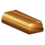{ width=40 } **[Aequalis Bar](../materials.md)** Common | A balanced arcane metal found only in fire regions, with Adamantite rarity. Smelt ore in a Furnace; use bars in Axo equipment recipes. | 1 Aequalis Ore. Furnace · 14s |
| 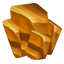{ width=40 } **[Aequalis Ore](../materials.md)** Common | A balanced arcane metal found only in fire regions, with Adamantite rarity. Smelt ore in a Furnace; use bars in Axo equipment recipes. | No crafting recipe. See the [guide](../materials.md) for gathering, drops or use. |
| 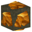{ width=40 } **[Aequalis Ore Deposit](../materials.md)** Common | See the linked guide for its role. | No crafting recipe. See the [guide](../materials.md) for gathering, drops or use. |
| 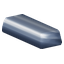{ width=40 } **[Agretis Bar](../materials.md)** Common | A foundational metal found with Iron rarity throughout the world. Smelt ore in a Furnace; use bars in Axo equipment recipes. | 1 Agretis Ore. Furnace · 14s |
| { width=40 } **[Agretis Ore](../materials.md)** Common | A foundational metal found with Iron rarity throughout the world. Smelt ore in a Furnace; use bars in Axo equipment recipes. | No crafting recipe. See the [guide](../materials.md) for gathering, drops or use. |
| 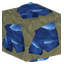{ width=40 } **[Agretis Ore Deposit](../materials.md)** Common | See the linked guide for its role. | No crafting recipe. See the [guide](../materials.md) for gathering, drops or use. |
| 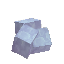{ width=40 } **[Arcane Crystal](../blocks-ores.md)** Common | See the linked guide for its role. | No crafting recipe. See the [guide](../blocks-ores.md) for gathering, drops or use. |
| { width=40 } **[Arcane Crystal Shards](../blocks-ores.md)** Common | See the linked guide for its role. | No crafting recipe. See the [guide](../blocks-ores.md) for gathering, drops or use. |
| 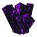{ width=40 } **[Arcane Matter](../blocks-ores.md)** Rare | Used to craft spellbooks and arcane equipment. | No crafting recipe. See the [guide](../blocks-ores.md) for gathering, drops or use. |
| 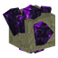{ width=40 } **[Arcane Matter Ore (Stone)](gear.md)** Common | A strange ore formation threaded through stone. | No crafting recipe. See the [guide](gear.md) for gathering, drops or use. |
| { width=40 } **[Azure Kelp](../npcs.md)** Common | See the linked guide for its role. | No crafting recipe. See the [guide](../npcs.md) for gathering, drops or use. |
| 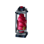{ width=40 } **[Blood Droplet](../blood-magic.md)** Uncommon | A sealed blood specimen. Extract from a living creature with the Bloody Book. Its species is saved in this item. | No crafting recipe. See the [guide](../blood-magic.md) for gathering, drops or use. |
| 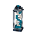{ width=40 } **[DNA Sample](../blood-magic.md)** Uncommon | A preserved bloodline. Convert a Blood Droplet with one Essence of Life in the Vitae Extractor. A properly bound sample names its source species. | No crafting recipe. See the [guide](../blood-magic.md) for gathering, drops or use. |
| { width=40 } **[Dreadmaw Blood Sample](../blood-magic.md)** Rare | Extract from a living Dreadmaw with the Bloody Book. One of four distinct samples needed to craft the Leech Book. Also usable in the Vitae Extractor. | No crafting recipe. See the [guide](../blood-magic.md) for gathering, drops or use. |
| { width=40 } **[Emberwulf Blood Sample](../blood-magic.md)** Rare | Extract from a living Emberwulf with the Bloody Book. One of four distinct samples needed to craft the Leech Book. Also usable in the Vitae Extractor. | No crafting recipe. See the [guide](../blood-magic.md) for gathering, drops or use. |
| 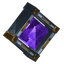{ width=40 } **[Evil Core](gear.md)** Rare | Heart of the Rune Knight A guaranteed Rune Knight drop. One core binds every crafted Axo armor or weapon piece. | Guaranteed Cursed Knight drop. |
| { width=40 } **[Revel Bar](../materials.md)** Common | A frost-touched metal found only in winter regions, with Cobalt rarity. Smelt ore in a Furnace; use bars in Axo equipment recipes. | 1 Revel Ore. Furnace · 14s |
| { width=40 } **[Revel Ore](../materials.md)** Common | A frost-touched metal found only in winter regions, with Cobalt rarity. Smelt ore in a Furnace; use bars in Axo equipment recipes. | No crafting recipe. See the [guide](../materials.md) for gathering, drops or use. |
| 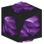{ width=40 } **[Revel Ore Deposit](../materials.md)** Common | See the linked guide for its role. | No crafting recipe. See the [guide](../materials.md) for gathering, drops or use. |
| { width=40 } **[Rex Blood Sample](../blood-magic.md)** Rare | Extract from a living Rex with the Bloody Book. One of four distinct samples needed to craft the Leech Book. Also usable in the Vitae Extractor. | No crafting recipe. See the [guide](../blood-magic.md) for gathering, drops or use. |
| 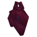{ width=40 } **[Spoiled Heart](scout-gear.md)** Legendary | A Legendary heart guaranteed from Dreadmaw. Three craft an Arcane Oraculum. | One guaranteed from every Dreadmaw kill. |
| { width=40 } **[Yeti Blood Sample](../blood-magic.md)** Rare | Extract from a living Yeti with the Bloody Book. One of four distinct samples needed to craft the Leech Book. Also usable in the Vitae Extractor. | No crafting recipe. See the [guide](../blood-magic.md) for gathering, drops or use. |

## World glyphs and internal states

| Item | Role and use | Crafting or acquisition |
| --- | --- | --- |
| { width=40 } **[Aequalis Ore Deposit](../materials.md)** Template | See the linked guide for its role. | World glyph or internal state; no separate crafting recipe. See its guide for progression. |
| { width=40 } **[Agretis Ore Deposit](../materials.md)** Template | See the linked guide for its role. | World glyph or internal state; no separate crafting recipe. See its guide for progression. |
| { width=40 } **[Alfa Rune](../skill-tree.md)** Technical | Break to absorb one rune. Spend runes at a fully grown Skill Tree. | World glyph or internal state; no separate crafting recipe. See its guide for progression. |
| { width=40 } **[Axo's Arcane Wand](arcane-equipment.md)** Epic | Voice of the Elder Grove Old roots remember every spell. Selected: Bloody Book. Uses the original spell cost and cooldown. Keep its book in your inventory or a carried Spellbook Pouch. RMB: cast. LMB: choose a spell. Crouch+RMB: alternate action. | Selected-spell state of the same wand. Use LMB to choose its spell; no separate craft. |
| { width=40 } **[Axo's Arcane Wand](arcane-equipment.md)** Epic | Voice of the Elder Grove Old roots remember every spell. Selected: Doom Book. Uses the original spell cost and cooldown. Keep its book in your inventory or a carried Spellbook Pouch. RMB: cast. LMB: choose a spell. Crouch+RMB: alternate action. | Selected-spell state of the same wand. Use LMB to choose its spell; no separate craft. |
| { width=40 } **[Axo's Arcane Wand](arcane-equipment.md)** Epic | Voice of the Elder Grove Old roots remember every spell. Selected: Flame Book. Uses the original spell cost and cooldown. Keep its book in your inventory or a carried Spellbook Pouch. RMB: cast. LMB: choose a spell. Crouch+RMB: alternate action. | Selected-spell state of the same wand. Use LMB to choose its spell; no separate craft. |
| { width=40 } **[Axo's Arcane Wand](arcane-equipment.md)** Epic | Voice of the Elder Grove Old roots remember every spell. Selected: Frost Book. Uses the original spell cost and cooldown. Keep its book in your inventory or a carried Spellbook Pouch. RMB: cast. LMB: choose a spell. Crouch+RMB: alternate action. | Selected-spell state of the same wand. Use LMB to choose its spell; no separate craft. |
| { width=40 } **[Axo's Arcane Wand](arcane-equipment.md)** Epic | Voice of the Elder Grove Old roots remember every spell. Selected: Heal Book. Uses the original spell cost and cooldown. Keep its book in your inventory or a carried Spellbook Pouch. RMB: cast. LMB: choose a spell. Crouch+RMB: alternate action. | Selected-spell state of the same wand. Use LMB to choose its spell; no separate craft. |
| { width=40 } **[Axo's Arcane Wand](arcane-equipment.md)** Epic | Voice of the Elder Grove Old roots remember every spell. Selected: Horde Book. Uses the original spell cost and cooldown. Keep its book in your inventory or a carried Spellbook Pouch. RMB: cast. LMB: choose a spell. Crouch+RMB: alternate action. | Selected-spell state of the same wand. Use LMB to choose its spell; no separate craft. |
| { width=40 } **[Axo's Arcane Wand](arcane-equipment.md)** Epic | Voice of the Elder Grove Old roots remember every spell. Selected: Immunity Book. Uses the original spell cost and cooldown. Keep its book in your inventory or a carried Spellbook Pouch. RMB: cast. LMB: choose a spell. Crouch+RMB: alternate action. | Selected-spell state of the same wand. Use LMB to choose its spell; no separate craft. |
| { width=40 } **[Axo's Arcane Wand](arcane-equipment.md)** Epic | Selected: Leech Book. Hold RMB to drain a living target within 16 blocks: 30 damage, 20 health restored and 10 mana spent each second. Carry its book or a Spellbook Pouch containing it. LMB: choose a spell. | Selected-spell state of the same wand. Use LMB to choose its spell; no separate craft. |
| { width=40 } **[Axo's Arcane Wand](arcane-equipment.md)** Epic | Voice of the Elder Grove Old roots remember every spell. Selected: Life Book. Uses the original spell cost and cooldown. Keep its book in your inventory or a carried Spellbook Pouch. RMB: cast. LMB: choose a spell. Crouch+RMB: alternate action. | Selected-spell state of the same wand. Use LMB to choose its spell; no separate craft. |
| { width=40 } **[Axo's Arcane Wand](arcane-equipment.md)** Epic | Voice of the Elder Grove Old roots remember every spell. Selected: Light Book. Uses the original spell cost and cooldown. Keep its book in your inventory or a carried Spellbook Pouch. RMB: cast. LMB: choose a spell. Crouch+RMB: alternate action. | Selected-spell state of the same wand. Use LMB to choose its spell; no separate craft. |
| 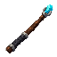{ width=40 } **[Axo's Arcane Wand](arcane-equipment.md)** Epic | Voice of the Elder Grove Old roots remember every spell. Selected: Lightning Book. Uses the original spell cost and cooldown. Keep its book in your inventory or a carried Spellbook Pouch. RMB: cast. LMB: choose a spell. Crouch+RMB: alternate action. | Selected-spell state of the same wand. Use LMB to choose its spell; no separate craft. |
| { width=40 } **[Axo's Arcane Wand](arcane-equipment.md)** Epic | Voice of the Elder Grove Old roots remember every spell. Selected: Meteorain Book. Uses the original spell cost and cooldown. Keep its book in your inventory or a carried Spellbook Pouch. RMB: cast. LMB: choose a spell. Crouch+RMB: alternate action. | Selected-spell state of the same wand. Use LMB to choose its spell; no separate craft. |
| { width=40 } **[Axo's Arcane Wand](arcane-equipment.md)** Epic | Voice of the Elder Grove Old roots remember every spell. Selected: Mining Book. Uses the original spell cost and cooldown. Keep its book in your inventory or a carried Spellbook Pouch. RMB: cast. LMB: choose a spell. Crouch+RMB: alternate action. | Selected-spell state of the same wand. Use LMB to choose its spell; no separate craft. |
| { width=40 } **[Axo's Arcane Wand](arcane-equipment.md)** Epic | Voice of the Elder Grove Old roots remember every spell. Selected: Morph Book. Uses the original spell cost and cooldown. Keep its book in your inventory or a carried Spellbook Pouch. RMB: cast. LMB: choose a spell. Crouch+RMB: alternate action. | Selected-spell state of the same wand. Use LMB to choose its spell; no separate craft. |
| { width=40 } **[Axo's Arcane Wand](arcane-equipment.md)** Epic | Voice of the Elder Grove Old roots remember every spell. Selected: Taunt Book. Uses the original spell cost and cooldown. Keep its book in your inventory or a carried Spellbook Pouch. RMB: cast. LMB: choose a spell. Crouch+RMB: alternate action. | Selected-spell state of the same wand. Use LMB to choose its spell; no separate craft. |
| { width=40 } **[Axo's Arcane Wand](arcane-equipment.md)** Epic | Voice of the Elder Grove Old roots remember every spell. Selected: Teleport Book. Uses the original spell cost and cooldown. Keep its book in your inventory or a carried Spellbook Pouch. RMB: cast. LMB: choose a spell. Crouch+RMB: alternate action. | Selected-spell state of the same wand. Use LMB to choose its spell; no separate craft. |
| { width=40 } **[Axo's Arcane Wand](arcane-equipment.md)** Template | Voice of the Elder Grove Old roots remember every spell. Cast spellbooks in your inventory or carried Spellbook Pouch. RMB: cast. LMB: choose a spell. Crouch+RMB: alternate action. | Selected-spell state of the same wand. Use LMB to choose its spell; no separate craft. |
| { width=40 } **[Beta Rune](../skill-tree.md)** Technical | Break to absorb one rune. Spend runes at a fully grown Skill Tree. | World glyph or internal state; no separate crafting recipe. See its guide for progression. |
| { width=40 } **[Chi Rune](../skill-tree.md)** Technical | Break to absorb one rune. Spend runes at a fully grown Skill Tree. | World glyph or internal state; no separate crafting recipe. See its guide for progression. |
| { width=40 } **[Delta Rune](../skill-tree.md)** Technical | Break to absorb one rune. Spend runes at a fully grown Skill Tree. | World glyph or internal state; no separate crafting recipe. See its guide for progression. |
| { width=40 } **[Epsilon Rune](../skill-tree.md)** Technical | Break to absorb one rune. Spend runes at a fully grown Skill Tree. | World glyph or internal state; no separate crafting recipe. See its guide for progression. |
| { width=40 } **[Eta Rune](../skill-tree.md)** Technical | Break to absorb one rune. Spend runes at a fully grown Skill Tree. | World glyph or internal state; no separate crafting recipe. See its guide for progression. |
| { width=40 } **[Gamma Rune](../skill-tree.md)** Technical | Break to absorb one rune. Spend runes at a fully grown Skill Tree. | World glyph or internal state; no separate crafting recipe. See its guide for progression. |
| 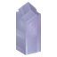{ width=40 } **[Growing Arcane Crystal](../blocks-ores.md)** Technical | Mine a wild Arcane Crystal for one guaranteed seed. Plant on prepared soil. Grows from small to medium to mature in 15 minutes. Harvest for 2-3 Arcane Crystal Shards; the crystal regrows. Breaking returns its seed. | World glyph or internal state; no separate crafting recipe. See its guide for progression. |
| { width=40 } **[Iota Rune](../skill-tree.md)** Technical | Break to absorb one rune. Spend runes at a fully grown Skill Tree. | World glyph or internal state; no separate crafting recipe. See its guide for progression. |
| { width=40 } **[Kappa Rune](../skill-tree.md)** Technical | Break to absorb one rune. Spend runes at a fully grown Skill Tree. | World glyph or internal state; no separate crafting recipe. See its guide for progression. |
| { width=40 } **[Lambda Rune](../skill-tree.md)** Technical | Break to absorb one rune. Spend runes at a fully grown Skill Tree. | World glyph or internal state; no separate crafting recipe. See its guide for progression. |
| { width=40 } **[Mu Rune](../skill-tree.md)** Technical | Break to absorb one rune. Spend runes at a fully grown Skill Tree. | World glyph or internal state; no separate crafting recipe. See its guide for progression. |
| { width=40 } **[Nu Rune](../skill-tree.md)** Technical | Break to absorb one rune. Spend runes at a fully grown Skill Tree. | World glyph or internal state; no separate crafting recipe. See its guide for progression. |
| { width=40 } **[Omega Rune](../skill-tree.md)** Technical | Break to absorb one rune. Spend runes at a fully grown Skill Tree. | World glyph or internal state; no separate crafting recipe. See its guide for progression. |
| { width=40 } **[Omicron Rune](../skill-tree.md)** Technical | Break to absorb one rune. Spend runes at a fully grown Skill Tree. | World glyph or internal state; no separate crafting recipe. See its guide for progression. |
| { width=40 } **[Phi Rune](../skill-tree.md)** Technical | Break to absorb one rune. Spend runes at a fully grown Skill Tree. | World glyph or internal state; no separate crafting recipe. See its guide for progression. |
| { width=40 } **[Pi Rune](../skill-tree.md)** Technical | Break to absorb one rune. Spend runes at a fully grown Skill Tree. | World glyph or internal state; no separate crafting recipe. See its guide for progression. |
| { width=40 } **[Psi Rune](../skill-tree.md)** Technical | Break to absorb one rune. Spend runes at a fully grown Skill Tree. | World glyph or internal state; no separate crafting recipe. See its guide for progression. |
| { width=40 } **[Revel Ore Deposit](../materials.md)** Template | See the linked guide for its role. | World glyph or internal state; no separate crafting recipe. See its guide for progression. |
| { width=40 } **[Rho Rune](../skill-tree.md)** Technical | Break to absorb one rune. Spend runes at a fully grown Skill Tree. | World glyph or internal state; no separate crafting recipe. See its guide for progression. |
| { width=40 } **[Sigma Rune](../skill-tree.md)** Technical | Break to absorb one rune. Spend runes at a fully grown Skill Tree. | World glyph or internal state; no separate crafting recipe. See its guide for progression. |
| { width=40 } **[Skill Tree](../skill-tree.md)** Technical | Interact with the fully grown tree to spend runes and learn permanent skills. | World glyph or internal state; no separate crafting recipe. See its guide for progression. |
| { width=40 } **[Tau Rune](../skill-tree.md)** Technical | Break to absorb one rune. Spend runes at a fully grown Skill Tree. | World glyph or internal state; no separate crafting recipe. See its guide for progression. |
| { width=40 } **[Theta Rune](../skill-tree.md)** Technical | Break to absorb one rune. Spend runes at a fully grown Skill Tree. | World glyph or internal state; no separate crafting recipe. See its guide for progression. |
| { width=40 } **[Upsilon Rune](../skill-tree.md)** Technical | Break to absorb one rune. Spend runes at a fully grown Skill Tree. | World glyph or internal state; no separate crafting recipe. See its guide for progression. |
| { width=40 } **[Xi Rune](../skill-tree.md)** Technical | Break to absorb one rune. Spend runes at a fully grown Skill Tree. | World glyph or internal state; no separate crafting recipe. See its guide for progression. |
| { width=40 } **[Zeta Rune](../skill-tree.md)** Technical | Break to absorb one rune. Spend runes at a fully grown Skill Tree. | World glyph or internal state; no separate crafting recipe. See its guide for progression. |
