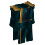

# Gear and Spellblade

  
Armor and weapon route

  
Axo Tales gear does more than pad stats. Sa'r supports mana and stamina, Ancient armor adds endgame abilities, the cloak offers stealth, and the swords combine melee with spellcasting.

## Arcane Veil robe

Three Rare pieces: **Arcane Veil Hood**, **Arcane Veil Robe**, **Arcane Veil Leggings**. Wear all three for these totals: **+30% movement speed, +25% maximum health, mana and stamina, +5 mana per second and 20% incoming damage absorption**. The light cloth pieces have minimal armor; hands remain free. Equipping the set increases capacity without refilling current stats.

Wearing the full set once **permanently unlocks one nine-slot Backpack row**, without needing a sword. Open **Inventory → Backpack**. Full **Sa'r** unlocks **18 bonus slots**; full **Ancient** unlocks **27**. Standard backpack scrolls retain their original upgrades. Other robe bonuses end on unequip. Older occupied overflow rows move safely into the backpack; the main inventory keeps its normal layout. Existing backpack items and other mods' storage sizes are preserved.

Native hostile NPCs outside **5 blocks** are suppressed within a 64-block observer scan; Axo Cursed Knights also check this range when choosing/firing at targets. Other mods' independent creature behavior can bypass native attitudes. This is stealth from NPCs rather than invisibility from players.

Craft each piece at **Arcanist's Workbench → Armor**, 6 seconds:

| Piece | Ingredients |
| --- | --- |
| Hood | 10 Linen Scraps, 5 Arcane Matter, 4 Arcane Crystal Shards, 4 Agretis Bar, 3 Revel Bar, 1 Evil Core. |
| Robe | 16 Linen Scraps, 4 Medium Leather, 8 Arcane Matter, 6 Arcane Crystal Shards, 8 Agretis Bar, 1 Evil Core. |
| Leggings | 12 Linen Scraps, 3 Medium Leather, 6 Arcane Matter, 4 Arcane Crystal Shards, 6 Agretis Bar, 1 Evil Core. |

For the complete Agretis/Revel/Aequalis bar costs, see [New Metals](../materials.md). Each crafted gear piece also requires one Evil Core.

## Shared Sa'r baseline

Wear all four pieces once to permanently earn **18 bonus Backpack slots**. It stays unlocked after changing armor, without needing a sword. Standard backpack scrolls add their normal capacity on top.

All four Sa'r pieces grant a further **+35% movement speed, +30% maximum health and mana, and 25% damage absorption** when worn together. These stack with their existing individual perks and resistances. The redesigned set has ridged navy-steel plates, violet cloth, restrained gold fittings and teal crystals, with broad painted shading and clean forged edges. Its tabards follow the legs; the open diadem keeps the wearer's hair visible. Existing piece powers and recipes are retained.

**Every crafted armor or weapon, including each recipe below and spellbooks, requires one Evil Core from a Cursed Knight.** The robe recipes above already include it.

  <h3>Sa'r armor bonuses</h3>
  
Each Sa'r armor item grants <strong>+25 max mana</strong> and <strong>+2 mana every 2 seconds</strong>, then layers on the set baseline: <strong>+10 stamina</strong>, <strong>+25% stamina regeneration</strong>, and <strong>+16% defense</strong>. Sa'r durability: <code>MaxDurability=500</code> and <code>DurabilityLossOnHit=0.5</code>.

  

    

      
    

    

      <h3>Sa'r Boots</h3>
      
The movement piece. Adds +15% move speed, roughly +2 blocks of jump height, one extra mid-air jump (press jump again after releasing it), and full fall-damage immunity. Its stamina bonus is the shared +10 maximum stamina per piece.

      
<strong>Craft</strong>: 4 Dark Feathers, 4 Cobalt Ingot, 6 Arcane Crystal Shards, 12 Arcane Matter, 8 Aequalis Bar, 1 Evil Core.

    

  

  

    

      
    

    

      <h3>Sa'r Diadem</h3>
      
The aquatic control piece. Adds +25 health on top of the shared mana and stamina baseline, then improves underwater breathing and swimming.

      
<strong>Craft</strong>: 4 Arcane Crystal Shards, 2 Cobalt Ingot, 8 Arcane Matter, 6 Aequalis Bar, 1 Evil Core.

    

  

  

    

      
    

    

      <h3>Sa'r Armor</h3>
      
The heavy scaler. Adds +75 health and +25% outgoing physical and projectile damage on top of the shared set stats.

      
<strong>Craft</strong>: 12 Cobalt Ingot, 20 Arcane Matter, 10 Arcane Crystal Shards, 10 Aequalis Bar, 1 Evil Core.

    

  

  

    

      
    

    

      <h3>Sa'r Warfists</h3>
      
The active hands slot. Adds +25 health, keeps the shared baseline, and fires a 25-damage projectile with a 2-second stun when you use unarmed primary attacks.

      
<strong>Craft</strong>: 2 Azure Kelp, 2 Arcane Matter, 2 Arcane Crystal Shards, 6 Aequalis Bar, 1 Evil Core.

    

  

## Ancient armor

Four separate **Legendary** pieces, crafted at **Arcanist's Workbench → Axo Tales Armor**. Formed moon-silver plates, ivory cloth, indigo leather and amethyst crystals distinguish this set from Sa'r. The open-face sallet encloses the scalp, while layered shoulders and shaped bracers and greaves follow the native body.

  

    

    

      <h3>Ancient Helm</h3>
      
Underwater breathing, 50% faster swimming and 10 mana every four seconds. Reflects incoming projectiles toward their attacker at 1.3 times base damage. Adds 40 health, 35 mana, 25 stamina and 30% stamina regeneration.

      
<strong>Craft</strong>: 24 Adamantite Ingot, 32 Aequalis Bar, 64 Arcane Matter, 48 Arcane Crystal Shards, 8 Voidheart, 4 Evil Core. Arcanist&#x27;s Workbench · 20s

    

  

  

    

    

      <h3>Ancient Chestplate</h3>
      
Crouch + Jump toggles flight with ten seconds of fuel; landing refills it. Hostile creatures detect you within four blocks. Adds 150 health, 20% maximum health, 25 stamina, 50% defense, 30% stamina regeneration and 30% melee/projectile damage.

      
<strong>Craft</strong>: 48 Adamantite Ingot, 64 Aequalis Bar, 128 Arcane Matter, 96 Arcane Crystal Shards, 16 Voidheart, 8 Evil Core. Arcanist&#x27;s Workbench · 20s

    

  

  

    

    

      <h3>Ancient Gauntlets</h3>
      
LMB with an empty hand throws a blue fireball for 71–110 base damage within four blocks. Adds 40 health, 35 mana, 25 stamina, 20% defense and 30% stamina regeneration.

      
<strong>Craft</strong>: 24 Adamantite Ingot, 32 Aequalis Bar, 64 Arcane Matter, 48 Arcane Crystal Shards, 8 Voidheart, 4 Evil Core. Arcanist&#x27;s Workbench · 20s

    

  

  

    

    

      <h3>Ancient Boots</h3>
      
30% faster movement, three blocks of extra jump height, one air jump and fall-damage immunity. Adds 40 health, 35 mana, 25 stamina, 20% defense and 30% stamina regeneration.

      
<strong>Craft</strong>: 32 Adamantite Ingot, 48 Aequalis Bar, 96 Arcane Matter, 64 Arcane Crystal Shards, 12 Voidheart, 6 Evil Core. Arcanist&#x27;s Workbench · 20s

    

  

| Piece | Maximum health | Maximum mana | Maximum stamina |
| --- | --- | --- | --- |
| Ancient Helm | +40 | +35 | +25 |
| Ancient Chestplate | +150 | — | +25 |
| Ancient Gauntlets | +40 | +35 | +25 |
| Ancient Boots | +40 | +35 | +25 |
| **Piece totals** | **+270** | **+105** | **+100** |

**Ancient Helm** also grants **+30% stamina regeneration**, underwater breathing, **+50% swimming speed** and **10 mana every four seconds**. Incoming projectiles ricochet toward their attacker with **1.3× base damage**. Returned projectiles use native collision and can be dodged or stopped by terrain; they cannot ricochet again.

**Ancient Chestplate** also grants **+20% maximum health**, **+50% defense**, **+30% stamina regeneration** and **+30% melee/projectile damage**. Hostile native NPCs detect the wearer only within **four blocks**. **Crouch + Jump** toggles flight with **ten seconds of fuel**. The flight bar shows remaining time; switching flight off pauses consumption, and landing refills it. Removing the chestplate ends flight; re-equipping it in mid-air does not refill the tank.

**Ancient Gauntlets** also grant **+20% defense** and **+30% stamina regeneration**. Select an **empty hotbar slot** and press **LMB** while aiming clear of nearby blocks and entities to throw a large blue fireball. A **0.32-second wind-up** leads into the throw, followed by a return to rest. Looking at a nearby block or entity preserves ordinary LMB actions. The fireball explodes on entity or terrain contact within a **four-block radius**, dealing one **71–110 base damage** roll to each affected target. It has a **0.9-second cooldown** and does no block damage.

**Ancient Boots** also grant **+20% defense**, **+30% movement speed**, **three blocks of extra jump height**, **one extra air jump** and fall-damage immunity. Release Jump between jumps. Durability is **900** per piece, or **1,200** for the chestplate.

Wear all four Ancient pieces for these **additional** bonuses:

- **+400 maximum health** as a flat addition after the chestplate's health scaling, and **+100 maximum stamina**.
- **+50% movement speed** and **+15% attack damage** across melee, projectiles and spells.
- **40% resistance to every elemental damage type** and **50% additional defense** against physical/projectile damage.
- **+50% maximum mana**, **10 mana every two seconds**, and **+50% stamina regeneration**.
- **One additional air jump**, giving **two air jumps** with the boots.
- Permanently unlock **27 bonus Backpack slots**. Existing contents and ordinary backpack upgrades remain intact.

The set bonus stacks with piece bonuses: boots and full set give **+95% movement speed** together; the chestplate and full set give **+49.5% melee/projectile damage**. Defense reduces damage remaining after ordinary armor. Mixing Ancient and Sa'r pieces keeps individual bonuses but grants neither complete-set bonus. Capacity refreshes do not refill current health, mana or stamina.

See [the complete recipes](../crafting.md#ancient-armor). Ancient armor uses its own item IDs and does not replace existing Sa'r equipment.

## Utility and specialty gear

  

    

      
    

    

      <h3>Invisibility Cloak</h3>
      
Stealth utility. Hides your character and equipment from other players and conceals you from native creatures. Your existing armor and skin return when the effect ends.

      
<strong>Acquire</strong>: no recipe by default, so treat it as admin, spawn, or curated-loot gear unless you add one.

    

  

  

    

      
    

    

      <h3>Arcane Sword</h3>
      
An Epic sword with its silver-edged blade, gold wing guard, violet core and lightning arcs. Carrying it adds +30 max mana. RMB fires Arcane Slash. 

      
<strong>Craft</strong>: 60 Arcane Matter, 48 Arcane Crystal Shards, 32 Fire Essence, 32 Ice Essence, 16 Voidhearts, 24 Aequalis Bars and 1 Evil Core; 12 seconds.

    

  

## Arcane Pickaxe

A full-size silver, gold and violet relic with violet motes. This **Epic** pickaxe has **1200 durability**. **LMB** excavates a **3×3×3 volume** into the targeted surface, within six blocks. A swing costs **10 mana and one durability only when it breaks at least one block**. Broken blocks release their normal mining drops under native loot and creative rules. It respects protection checks and skips bedrock, containers and workbenches.

Craft at **Arcanist's Workbench → Spellblades**, **12 seconds**: **6 Revel Bars, 4 Aequalis Bars, 4 Arcane Matter, 8 Arcane Crystal Shards, 2 Heavy Leather and 1 Evil Core**.

## Numbers worth remembering

- Arcane Sword controls: LMB uses native longsword attacks/charged stab; RMB casts Arcane Slash.
- Arcane Sword primary swings: 83 physical base damage.
- Arcane Sword charged stab: 105 physical base damage with a longer forward dash.
- Arcane Sword primary attacks/charges run 20% faster, with matching animation playback.
- Normal and charged melee hits push enemies outward, tuned for roughly **3–4 blocks** on open ground; obstacles and knockback resistance affect travel.
- Arcane Slash projectile: 50 damage, 20 mana, 1.25s cooldown, 0.34s cast delay by default.
- Warfists projectile: 25 damage and 2-second stun while worn and unarmed.

## Ancient Sword

A separate **Legendary** greatsword with a larger closed blade, continuous silver cutting planes and an amethyst channel. **LMB** retains the native longsword combo: **160 base damage** on ordinary swings and **200** on the charged stab. **RMB** releases a **100-damage slash** after a **0.34-second wind-up**, for **30 mana**, with a **1.25-second cooldown**. Durability: **1,500**.

Craft at **Arcanist's Workbench → Axo Tales Spellblades**, **24 seconds**: **1 Arcane Sword, 64 Adamantite Bars, 96 Aequalis Bars, 160 Arcane Matter, 128 Arcane Crystal Shards, 24 Voidhearts and 12 Evil Cores**. The Arcane Sword is consumed as an ingredient. Existing Arcane Swords remain the Epic item until crafted into this separate weapon.

## Mana with other mods

Axo gear adds its bonuses to Hytale's native Mana stat. Other mods' native mana capacity, modifiers and regeneration can coexist with these bonuses; taking Axo gear off does not empty their pool. Mods that implement a separate private mana resource need their own integration.

## Bloodfang Daggers

Epic dual recurved blades with continuous silver cutting edges, gold guards, indigo grips and amethyst seals. **Grounded LMB attacks** add a short forward dash, at most once every **0.4 seconds**. The dash cannot stack and slows equally on the ground and in the air. Jumping just after LMB keeps the ordinary dagger combo without triggering a pounce launch. Basic hits add a small outward knockback. **30 physical damage per basic hit**, **100 total across the full signature** (30 + 30 + 40), with **60% faster attack cadence than native daggers**. RMB guards; the native signature requires its normal energy charge. Damage remains subject to armor/protection. Existing Starfang/Bloodfang items display Bloodfang Daggers automatically.

Craft at **Arcanist's Workbench → Axo Tales Spellblades**, 12 seconds: 24 Arcane Matter, 16 Arcane Crystal Shards, 10 Heavy Leather, 16 Revel Bars, 12 Aequalis Bars and 1 Evil Core.

## Rimefang

A Rare glacial steel sword with a cyan fuller, cold-silver guard and navy grip. It uses native sword combos, RMB guard and the sword signature. Normal attacks deal **11 / 14 / 21 / 32 base physical damage**, matching cobalt sword strength.

Successful, unblocked hits freeze the enemy for **2 seconds**, stopping movement and attacks. More hits refresh the two-second timer. Blocked and cancelled hits do not apply freeze.

Craft at **Arcanist's Workbench → Spellblades**: **8 Cobalt Bars, 6 Ice Essence, 4 Arcane Matter, 3 Medium Leather, 10 Revel Bars and 1 Evil Core**; 6 seconds. Durability: 150.

Arcane Veil Leggings cover your footwear while equipped, following native leggings behavior.
