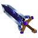
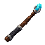
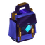
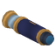
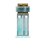

# Arsenal

The [item catalog](catalog.md) lists every item and its recipe. The pages below explain how to use them.

## Equipment and items {#collection-map}

  <a class="guide-path" href="gear/">
<h3>Gear and spellblade</h3>
Three armor sets, swords, Bloodfang Daggers, pickaxes and stealth equipment.

</a>
  <a class="guide-path" href="spellbooks/">
<h3>Spellbooks</h3>
Seventeen books for healing, travel, mining, combat and blood magic.

</a>
  <a class="guide-path" href="arcane-equipment/">
<h3>Wand and pouch</h3>
Cast spells from carried books. The pouch holds up to 18 books.

</a>
  <a class="guide-path" href="astral-satchel/">
<h3>Astral Satchel</h3>
Store items, search the bag and use its ingredients at workbenches.

</a>
  <a class="guide-path" href="scout-gear/">
<h3>Arrows and Spyglass</h3>
Elemental shortbows, homing Ancient Arrows, target inspection and the Oraculum.

</a>
  <a class="guide-path" href="potions/">
<h3>Potions</h3>
Drinkable speed, strength, jump and invisibility buffs, plus the throwable Curse Potion.

</a>

## Crafting and armor {#how-the-arsenal-hangs-together}

Most equipment uses Arcane Matter, Crystal Shards and Evil Cores from Cursed Knights. Some recipes also need Agretis, Revel or Aequalis Bars from their respective regions. Armor improves your stats and grants bonuses for a complete set. Wearing a complete Veil, Sa'r or Ancient set also unlocks permanent Backpack space.

## Next pages

- [Gear and Spellblade](gear.md) for armor bonuses, weapons and pickaxe controls.
- [Spellbooks](spellbooks.md) for every book's action and cast timing.
- [Crafting Flow](../crafting.md) for workbench tabs and progression.
- [Blood Magic](../blood-magic.md) for blood, DNA, companions and specimen storage.

## Casting with the wand {#one-focus-for-your-collection}

The [Arcane Wand and Spellbook Pouch](arcane-equipment.md) let you store books together and select their spells with LMB. You can also use loose books from your inventory or cast directly from a book in your hand.
