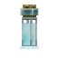
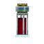
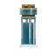
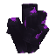
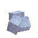

# Arsenal

Browse the [complete item catalog](catalog.md) for every item, its actual crafting cost and the relevant controls guide, including the new shortbows, Spoiled Heart and Arcane Oraculum.

  
What you can build around

  
Axo Tales splits cleanly into gear, spellbooks, potions, and world-fed utility. This section is the quickest way to understand what belongs in a loadout and what each lane is good at.

## Collection map

  <a class="card media-card" href="gear/" data-reveal>
    

      
      
      
    

    

      <h3>Gear and spellblade</h3>
      
Mana scaling, movement perks, invisibility, Warfists stun shots, and both arcane swords.

    

  </a>
  <a class="card media-card" href="spellbooks/" data-reveal>
    

      
      
      
    

    

      <h3>Spellbooks</h3>
      
Twelve books that cover healing, blink, mining, summoning, burst, terrain control, and utility light.

    

  </a>
  <a class="card media-card" href="potions/" data-reveal>
    

      
      
      
    

    

      <h3>Potions</h3>
      
Fast drinkable buffs plus one throwable curse lane, all built off Axo's Empty Potion Bottle.

    

  </a>
  <a class="card media-card" href="../blocks-ores/" data-reveal>
    

      
      
      
    

    

      <h3>World resources and blocks</h3>
      
Arcane Matter, deterministic crystals, creature drops, and the Cloud/Bounce movement pair.

    

  </a>

## How the arsenal hangs together

  

    <h3>Start with resource access</h3>
    
Arcane Matter and Arcane Crystal Shards are the real spine of the mod. Once those are flowing, every other lane opens quickly.

  

  

    <h3>Mana gear makes the books better</h3>
    
Axo Tales armor pieces add max mana and mana regeneration, so spellbooks feel much better once you have at least one real gear piece online.

  

  

    <h3>Encounters and equipment</h3>
    
Cursed Knights supply Evil Cores for equipment. Elder Mages accept Arcane Crystals and assist in combat.

  

## Next pages

- [Gear and Spellblade](gear.md) if you want to choose a build anchor first.
- [Spellbooks](spellbooks.md) if you want the click-by-click book reference.
- [Crafting Flow](../crafting.md) if you want the fastest progression order.

## One focus for your collection

The [Arcane Wand and Spellbook Pouch](arcane-equipment.md) let you carry books in one container and select their spells with LMB. Direct book casting remains available.

For expandable storage, see [Axo's Astral Satchel](astral-satchel.md): three-row search, view filters and draggable paging.

For homing ammunition and a focused target readout, see [Ancient Arrows and Axo's Spyglass](scout-gear.md), including the complete configurable display-field list.
