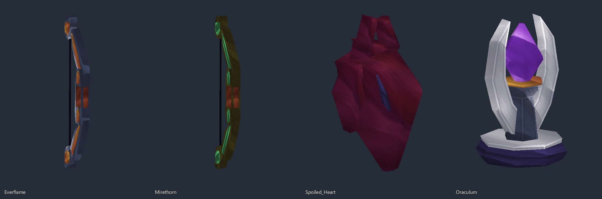

# Shortbows, Ancient Arrows and Arcane Oraculum

Use shortbows, homing Ancient Arrows and the Spyglass to fight at range. The Arcane Oraculum is a single-use device with a 250-block blast radius.



## Everflame and Mirethorn Shortbows

Hold **LMB** to draw, then release to shoot. Both keep Hytale's native shortbow draw, guard and signature volley. Their damage follows Cobalt and Thorium shortbows respectively.

**Everflame** is an Epic forged steel shortbow with copper inlays. It never consumes arrows, including Ancient Arrows. With no ammunition, it creates an ordinary arrow. Hits ignite enemies for **4 seconds**.

**Mirethorn** is a Rare olivewood shortbow with jade inlays. Every arrow type applies **poison and a 25% movement slow for 6 seconds**. Repeated hits refresh these effects. It consumes one arrow per successful release. Crude, Iron, Deadeye, Clearshot, Trueshot and Ancient Arrows are supported. Ancient Arrows retain their homing, impact and splash; both bows add their effects to accepted projectile hits.

The bows select Ancient Arrows first, then ordinary arrows in Hotbar, Inventory and Backpack order. Ancient Arrows still require a visible living target within 96 blocks. Cancelled draws, invalid locks and failed projectile creation do not consume ammunition.

Craft either at **Arcanist's Workbench → Spellblades**, **12 seconds**:

| Shortbow | Ingredients |
| --- | --- |
| Everflame — medium-hard | 24 Cobalt Bars, 24 Fire Essence, 32 Arcane Matter, 8 Voidhearts, 12 Heavy Leather, 8 Aequalis Bars, 1 Evil Core |
| Mirethorn — medium | 16 Thorium Bars, 8 Venom Sacs, 12 Medium Leather, 24 Plant Fibre, 16 Arcane Matter, 1 Evil Core |

## Arcane Oraculum

Every **Dreadmaw** kill guarantees **one Legendary Spoiled Heart** alongside its existing loot. Craft **one Legendary Arcane Oraculum** from **3 Spoiled Hearts, 55 Arcane Matter, 12 Arcane Crystal Shards and 12 Revel Bars** at **Arcanist's Workbench → Spellblades**, **16 seconds**. Hearts have no crafting recipe.

Place the Oraculum, then press **RMB / Use** while looking at it. Activation spends **all current mana** and requires a positive mana balance. Its silver arms open around a rising crystal during the **five-second charge**, then it detonates in a large blast with dust, fire and sound.

The blast deals **4,000 base damage** to every living entity within a **250-block sphere**, **including the activator**, with no distance falloff or terrain occlusion. Native defenses and invulnerability still apply. It consumes **only the Oraculum itself**; terrain and structures are preserved. An armed device cannot be mined to recover it. Its saved fuse cannot be activated twice; an unloaded overdue fuse resolves once when its chunk next loads.

## Ancient Arrows

Carry **Ancient Arrows** in Hotbar, Inventory or Backpack and equip a standard shortbow. Hold **LMB for at least 0.35 seconds**, aim the crosshair at a visible living target within **96 blocks**, then release. Ancient Arrows take priority over ordinary arrows for normal shots. Native bow signatures keep their normal behavior and ammunition.

The released arrow locks onto that target, follows its movement and passes through intervening terrain. It deals **180 impact damage** and **60 splash damage within a four-block radius**. The locked target takes the impact damage once; the caster is excluded from the blast. There is **no block damage**. Normal game damage protections still apply. A shot without a valid visible target consumes no arrow. Dead, unloaded or departed targets cancel the shot; it never switches to another target. Release cooldown is **0.8 seconds**. Custom bows and crossbows are not routed.

Craft **four arrows** at **Arcanist's Workbench → Spellblades**, twelve seconds:

| Ingredient | Quantity |
| --- | ---: |
| Adamantite Bars | 8 |
| Aequalis Bars | 8 |
| Revel Bars | 8 |
| Arcane Matter | 12 |
| Arcane Shards | 16 |
| Light Feathers | 8 |
| Evil Core | 1 |

Epic quality; stacks to 64. Item ID: `AxoTales_Ancient_Arrow`.

## Axo's Spyglass

An indigo leather barrel, brass collars and a silver drawtube surround recessed blue lenses. The dark eyecup fits against the face while focusing.

Hold **RMB** to raise the spyglass, focus at **6× magnification**, and read the entity in the crosshair within **120 blocks**. Release to lower it. It uses native focus/depth of field, reduced look sensitivity and a dark outer lens mask. A readout with 56-pixel left and 64-pixel top margins, 24-pixel internal padding, and indigo/gold styling appears in the upper-left corner while focused.

The default display is **Name, Health, Mana when available, and Range**. It reads actual server stats and does not reveal entities behind terrain. Missing stats and stats without a usable capacity are omitted. Updates occur about every 150 ms. A clear crosshair shows “No target”. The spyglass adds its own HUD layer and removes only that layer on release, death or unequip.

Craft one at **Arcanist's Workbench → Spellblades**, six seconds: **6 Copper Bars, 2 Revel Bars, 2 Arcane Matter, 1 Void Crystal**. Rare quality; does not stack. Item ID: `AxoTales_Spyglass`.

## Complete display-field list

**Name is always the header.** Players show their username; NPCs use a localized role name, with real nameplate/display-name overrides when present. The remaining rows are configurable in the plugin data directory's `spyglass-display.json`, created automatically on first load. Up to **seven rows** appear in the configured order. Restart the world/server after changing this file.

```json
{
  "fields": ["health", "mana", "distance"]
}
```

| Field key | What it displays |
| --- | --- |
| `health` | Current HP / maximum HP |
| `health_percent` | HP as a percentage of usable capacity |
| `mana` | Current mana / maximum mana, if present |
| `mana_percent` | Mana percentage, if present |
| `stamina` | Current stamina / maximum stamina |
| `oxygen` | Current oxygen / maximum oxygen |
| `signature_energy` | Current signature energy / maximum |
| `ammo` | Current native Ammo stat / maximum; this is a stat, not an inventory count |
| `role` | Internal NPC role ID, or Player/Entity |
| `distance` | Viewer-to-target distance in blocks |
| `position` | Target X, Y, Z |
| `world` | Current world name |
| `uuid` | Persistent entity UUID, when present |
| `stat:<ID>` | Any registered stat present on that entity, current / maximum; IDs are case-sensitive |

The installed native stat IDs are `Ammo`, `DeployablePreview`, `GlidingActive`, `Health`, `Immunity`, `MagicCharges`, `Mana`, `Oxygen`, `SignatureCharges`, `SignatureEnergy`, `Stamina`, and `StaminaRegenDelay`. For example, use `stat:MagicCharges` or `stat:SignatureCharges`. Some are internal meters and may be absent or have no displayable capacity; their presence in the registry does not mean every creature has them. Other mods' registered stats work through the same `stat:<ID>` syntax.

Long values receive an ellipsis to fit the card. This release exposes the fields listed above; equipment, inventory contents, faction, owner, resistances and active effects are not display fields.
