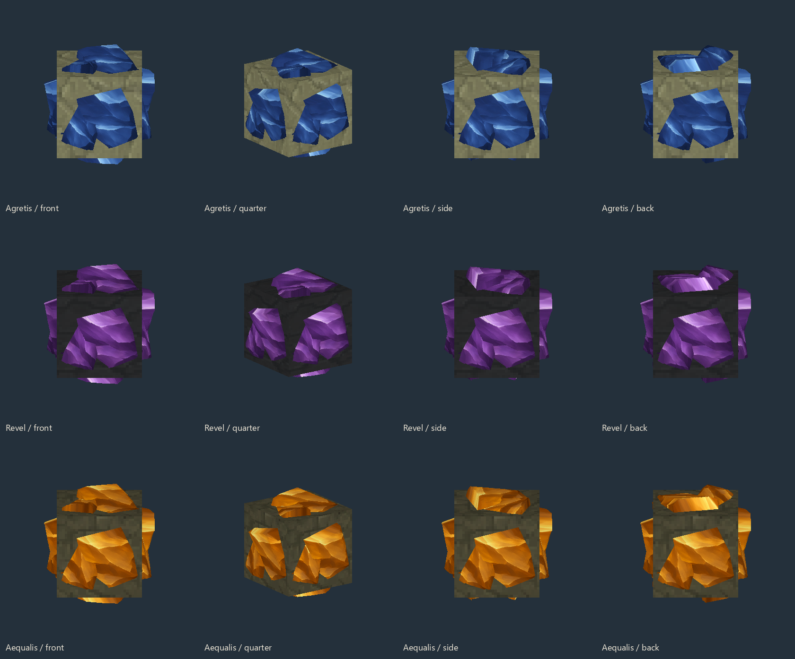
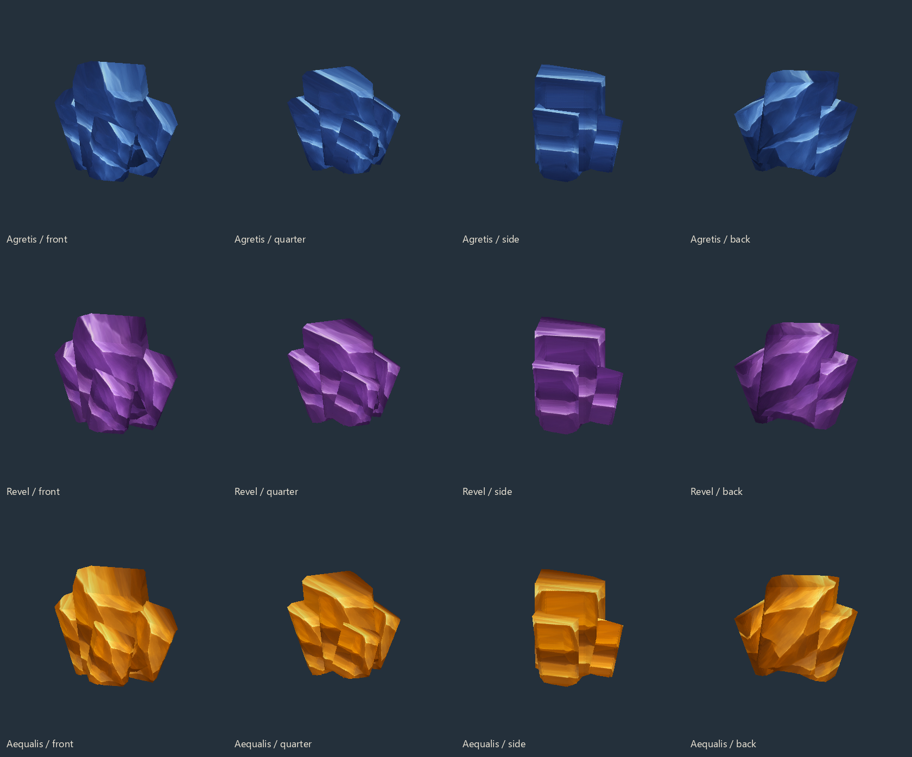

# Agretis, Revel and Aequalis

The three ores have thick, broken mineral clusters on all six faces of their native stone, slate and basalt hosts, with matching loose clusters and small colored particles. Agretis is sapphire blue, Revel is violet and Aequalis is amber gold. Loose ore uses the same hand pose as native Iron and Gold. Mine their deposits, then smelt **one raw ore into one bar** at a **Furnace** in 14 seconds.

| Ore | Where to find it | Rarity |
| --- | --- | --- |
| Agretis | Native Iron-bearing regions throughout the default world | Matches Iron |
| Revel | Winter regions in Zone 3 | Matches winter Cobalt |
| Aequalis | Fire regions in Zone 4 | Matches Adamantite |

These veins use the native ores' density, size and height rules, with separate positions. **Explore newly generated terrain after updating.** Existing mined areas and builds are preserved. Cracked surrounding rock gives the native stone material; the solid ore in the vein gives the new raw ore.

## New equipment costs

These bar costs are included in each item's recipe. Ordinary crafted armor, weapons and spellbooks require **one Evil Core** per piece; Ancient endgame equipment requires the larger Core quantities in [the complete recipes](crafting.md#ancient-armor).

| Item | Bar ingredients |
| --- | --- |
| Arcane Wand | 6 Agretis |
| Spellbook Pouch | 4 Agretis |
| Whisperion Saddle | 4 Agretis |
| Arcane Hood | 4 Agretis + 3 Revel |
| Arcane Robe | 8 Agretis |
| Arcane Leggings | 6 Agretis |
| Rimefang | 10 Revel |
| Frost Book | 4 Revel |
| Sa'r Diadem | 6 Aequalis |
| Sa'r Chest | 10 Aequalis |
| Sa'r Warfists | 6 Aequalis |
| Sa'r Boots | 8 Aequalis |
| Ancient Helm / Gauntlets | 32 Aequalis each |
| Ancient Chestplate | 64 Aequalis |
| Ancient Boots | 48 Aequalis |
| Arcane Sword | 24 Aequalis |
| Ancient Sword | 96 Aequalis |
| Ancient Arrows (four) | 8 Aequalis + 8 Revel |
| Lightning Book | 20 Revel |
| Meteorain Book | 20 Aequalis |
| Bloodfang | 16 Revel + 12 Aequalis |
| Doom Book | 4 Aequalis |

Agretis supports general equipment, Revel supports frost magic, and Aequalis supports advanced arcane equipment. Souls retain their existing Evil Core, Azure Kelp and special-item recipes. Current items and their saved upgrades remain usable.

## Ores and bars

Bars have smooth cast-metal faces and sharp bevels. Loose ores and deposits have matching fracture shapes and distinct colors. Their surrounding host rock uses the native stone material.

## Spoiled Heart

**Legendary**, guaranteed **one per Dreadmaw kill**. Three, together with 55 Arcane Matter, 12 Arcane Crystal Shards and 12 Revel Bars, craft a single-use [Arcane Oraculum](items/scout-gear.md#arcane-oraculum) at Arcanist's Workbench → Spellblades. It has no crafting recipe.

