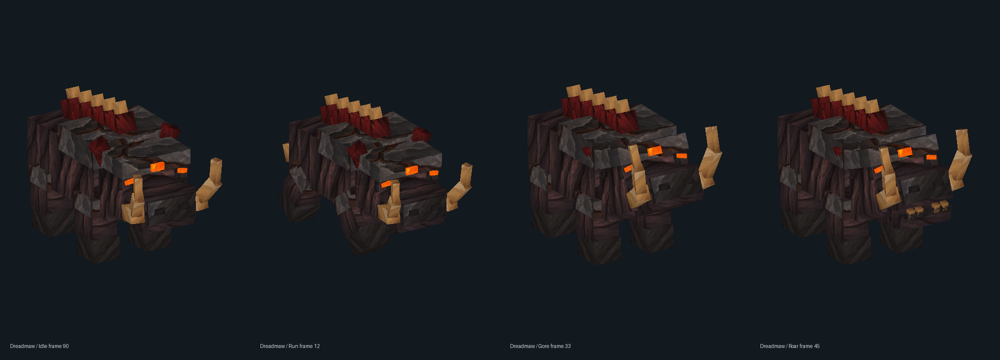
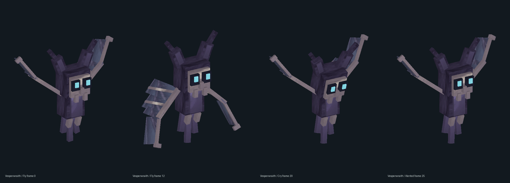
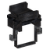
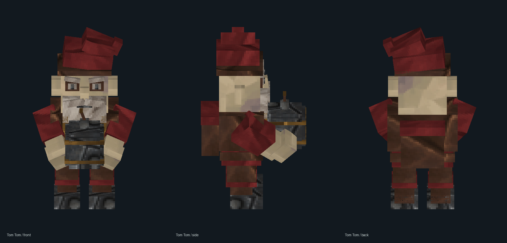

# NPCs and Encounters

  
Arcane encounters

  
Find Whisperion for early flight, face Cursed Knights for progression materials, or bond with Elder Mages using Arcane Crystal drops.

## Dreadmaw

An extremely rare infernal warboar: heavy charcoal hide, armored shoulders, an oxblood mane, curved ivory tusks and ember eyes. This large world miniboss has **1,440 health** and a **672-base-damage gore** with a visible **0.55-second windup**, then a recovery pause. It pursues on the ground, threatens with a roar and resists knockback.

Dreadmaw appears alone in the first region's native skeleton environments: plains, forests, mountains, autumn woods, swamps and Azure areas. Its selection weight is **9/100,000 of the combined skeleton weight**; this is a relative encounter weight, not a per-minute promise. Native population, surface-clearance and despawn rules apply.

Guaranteed drops: **1–4 Arcane Crystal Shards**, **1 Evil Core**, **1 Arcane Sword**, **1 Legendary Spoiled Heart**, and **15 each Light, Medium and Heavy Hide**. Independent extra rolls: **1 Arcane Matter at 50%**, **1 Rimefang at 1%**, **1 Lightning Book at 10%**, and **1 Meteor Rain Book at 10%**.

## Chiro

A small hostile ghost bat with bone-framed wings, a pale mask, cyan eyes and trailing spectral wisps. It has **60 health** and circles using native flight at low altitude. Its spectral echo deals **12 damage**, with a brief audible/visible tell before release. Wing joints keep flapping while it attacks.

Chiro appears alone or in groups of **up to 4** in the first region's skeleton spawn pools, at **1/10,000 of the combined skeleton selection weight**. It can spawn when only one population slot is available. Native terrain and population rules can limit a flock. The pools retain their all-day window and population management.

Guaranteed drops: **1–4 Arcane Crystal Shards**, **1 Evil Core** and **8 Light Hide**. Independent extra rolls give **one Arcane Matter at 50%** and **one Rimefang at 1%**.

## Whisperion

Whisperion is a raven-black flying horse with black feathered wings, a layered mane/tail, restrained silver details and dark stitched tack when saddled. Fourteen clips cover ground movement, flight strokes, gliding, takeoff/landing, feeding and reactions.

Wild Whisperions spawn through the normal creature ecology on **soil in Zone 1 plains, forests, autumn woods and Azure areas**, during **day and night**. They appear singly, with a selection weight of **2** compared with the vanilla horse's **5**. Native terrain, loaded-area and population rules apply. Tamed horses retain their owner and saddle and are protected from natural despawning.

1. Hold **Azure Kelp** and press **RMB** on Whisperion. One kelp guarantees taming; Azure Fruit does not work.
2. Craft a **Whisperion Saddle** at **Workbench → Tools**: 8 Light Leather, 4 Linen Scraps, 2 Iron Bars, 4 Agretis Bars, 4 seconds. No Evil Core.
3. Press **RMB** while holding the saddle, then **Interact** to ride. **WASD** steers, **Space** rises, **Crouch** descends and **Interact** dismounts.
4. Retrieve the saddle while unmounted using **empty hand + Crouch + Interact**. A full inventory leaves it fitted.

Ownership and tack are saved on the horse; other players cannot ride or retame him. Native dismount restores ordinary movement.

## Cursed Knight

  

    
  

  

    <h3>Hostile ranged encounter</h3>
    
Cursed Knights are the reliable progression encounter. They spawn at night, fight at range and drop core progression materials.

  

### Cursed Knight loot

- Guaranteed: **1 Evil Core**, required for every crafted Axo armor, weapon and spellbook piece.
- Guaranteed: 1 to 2 Arcane Crystal Shards.
- Guaranteed: 1 Arcane Matter.
- Configurable chance: Frost Book, default 5%.
- Bonus drop pool: Cloud Block or Bounce Block.

### Cursed Knight shipped defaults

The knight wears black iron, bone horns and dark armored leg cloth, with violet heart/eye particles. Its idle, movement, casting, alert, hurt, spawn and death poses use an eleven-clip animation set.

- Spawn interval: 62.5 seconds.
- Spawn attempts per interval: 12.
- Active cap per world: 8.
- Spawn radius band: 24 to 96 blocks from players.
- Projectile cooldown: 1.25 seconds.
- Projectile range: 24 blocks.
- Despawn on day: enabled.

## Elder Mage

The Elder Mage has a silver beard and swept hair, teal robes with ivory trim, a fitted neck and a walnut staff held at the palm. Eight clips cover idle, walking, running, casting, greeting, hurt, spawn and death.

  

    
  

  

    <h3>Friendly companion lane</h3>
    
Elder Mages spawn naturally, wander and attack nearby wild creatures while sparing players and pets. Drop an Arcane Crystal Shard or Arcane Crystal to bond one to its exact dropper. That owner is retained through saves and restarts; the creative spawner lists Elder_Mage.

  

[Current exported Cursed Knight, Elder Mage, Fossor and Gray Cat views](assets/images/npcs/tales-262.png)

Elder Mages have a daytime spawn opportunity every **50 seconds**, with a **50%** roll for an eligible density cell. Loaded terrain and existing population limits still apply.

### How bonding works

- Wild and bonded Mages display only **Elder Mage** above their heads.
- Drop an Arcane Crystal Shard or Arcane Crystal item near an unbonded Adept.
- The player who dropped it becomes that Adept's master.
- The mod shows the handoff with pickup behavior and bond particles.
- The Adept keeps that owner relationship even if the owner later logs out.

### Bonded Adept behavior

- Follows the owner instead of free-roaming socially.
- Uses native ground navigation and stays about three blocks from the owner when idle.
- Finds nearby mobs whose native attitude toward the owner is hostile, as well as assisting accepted owner attacks and retaliation.
- Can catch up with teleport logic if it falls too far behind.
- Uses ranged attacks instead of trying to fake a melee role.
- Holds about ten blocks from an enemy and releases a real 18-damage bolt after its staff windup, on a 1.35-second cycle.
- Focuses on the non-player target the owner last damaged.
- Drops 1 Arcane Crystal Shard and 1 Arcane Matter on death.
- Shares the Cloud and Bounce bonus-drop pool.

### Adept shipped defaults

- Spawn interval: 60 seconds.
- Spawn attempts per interval: 12.
- Density cell size: 192 blocks.
- Cell spawn chance: 50%.
- Spawn radius band: 24 to 112 blocks from players, at least 16 blocks from any player.
- Despawn on night: disabled.
- Timed despawn: disabled.

## Helpful Souls

Craft Villa, Fossor and Cruor with an Evil Core, three Azure Kelps and a special ingredient. These immortal companions collect stacks into chests, mine conjured resources, or guard their owner. See [Helpful Souls](souls.md) for recipes, controls and Fossor's complete upgrade table.

## Finding Arcane encounters

- Cursed Knights are one of the cleanest ways to convert combat into Arcane materials.
- Adepts give the mod a companion loop instead of only more gear.
- Both encounter lanes can feed the movement-block bonus pool, so the Arcane encounters also bleeds into traversal builds.

### Whisperion population limits

Wild spawning uses its own **600-second night interval**, with a persistent default cap of **three wild horses per world**, including unloaded horses. New spawns keep **48 blocks apart** and allow at most **two wild horses within 96 blocks**. Every ten seconds, including daylight, excess or aged wild horses can retire once they are **64 blocks from all players**. Tamed, saddled and ridden horses are protected. Existing unloaded legacy horses enter the census when their chunks load.

## Gray Cat

[Current slimmer Gray Cat model views](assets/images/npcs/tales-262.png)

A dark-gray cat with light-gray ears. Drop **one raw fish** nearby to tame him with a **100% chance**. All raw-fish rarities work. He approaches the dropped fish and belongs to the player who dropped it.

He wanders freely within **15 blocks**, follows when you move farther away, and catches up to a safe spot if left behind. Ownership survives restarts. Cross-world following transfers the same saved cat; it does not create a copy.

Wild cats spawn only on the surface of the **first region**, on an **independent 600-second interval** during the same night window. Wild population limits prevent clutter. Tamed cats remain protected from wild cleanup.

## Tom Tom

A hostile dwarf with **80 HP**. He runs toward players carrying a bomb, throws it and dies when it explodes. After a **1.2-second fuse**, the bomb deals up to **52 damage**, with a **4.25-block horizontal radius** and **12.75-block reach upward and downward**. Damage falls off toward the edge, and the blast preserves terrain. Killing him also uses his normal drops: **one Evil Core and2–5 Arcane Crystal Shards**, guaranteed.

Tom Tom spawns through native creature ecology on **soil in Zone 1 plains, forests, autumn woods and Azure areas**, during **day and night**. He appears singly with a selection weight of **2.5**. Native terrain and local population rules control suitable locations and replenishment.

## Encounter frequency

Cursed Knights use a night encounter clock, and Elder Mages have daytime opportunities. Whisperion and Tom Tom use native creature ecology in the listed habitats, with Tom Tom weighted slightly higher. Gray Cats keep their own clock. Suitable loaded ground and native population space affect sightings.
